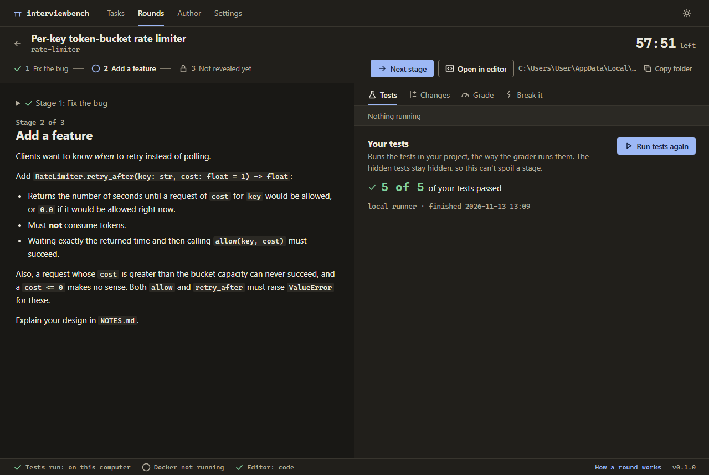
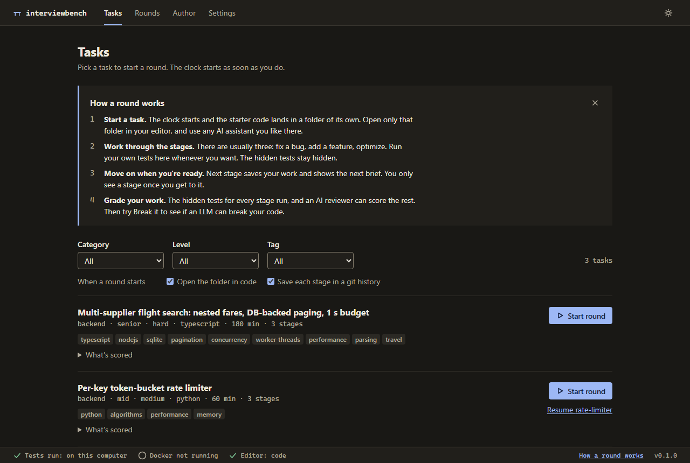
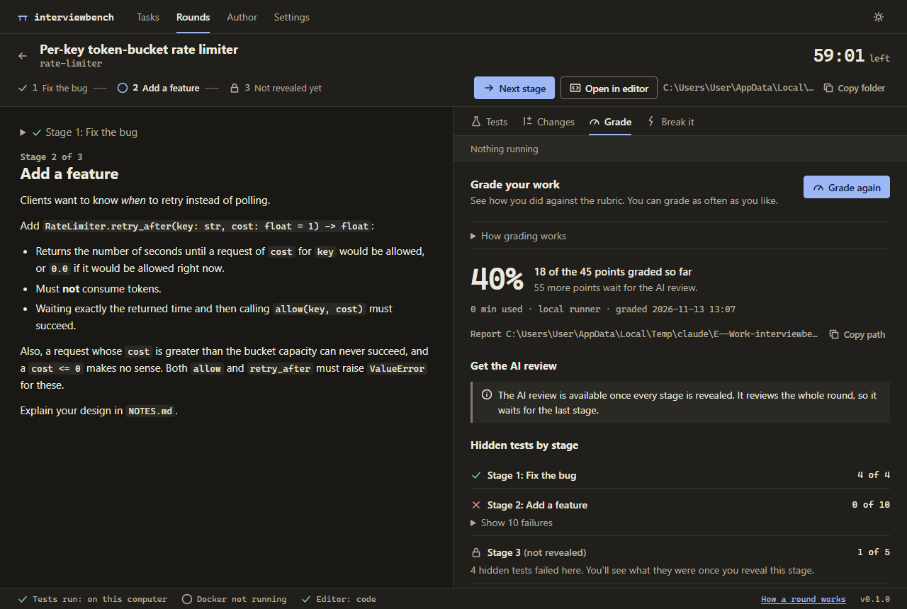
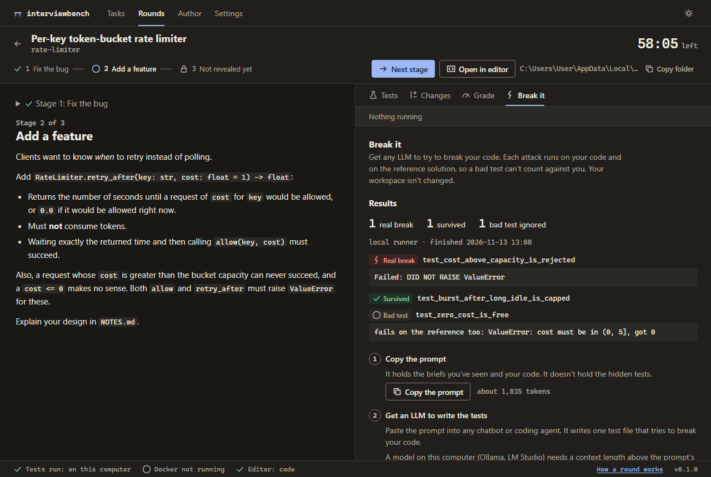

# interviewbench

Practice tasks for AI-assisted coding interviews, with hidden tests, a rubric and a grader (`ib`)
that runs on your own machine. For engineers preparing for interviews where AI tools are allowed.

[](https://github.com/Samiur-UTI/interviewbench/actions/workflows/ci.yml)
[](LICENSE)
[](pyproject.toml)



## What you get

- **Three original tasks**, each a small multi-file repo in three stages: fix a bug, add a feature,
  then optimize. One is Python, two are TypeScript.
- **A grader** that runs hidden tests and scores a weighted rubric, without spoiling the stages you
  haven't reached.
- **A browser GUI and a CLI** over the same rounds. Use your own editor and AI tools.
- **An optional AI judge** for what tests can't measure, and `ib break`, which asks an LLM to break
  your code.
- **Harbor tasks**: the same folders score AI coding agents with [Harbor](https://harborframework.com).

## Contents

[Quickstart](#quickstart) · [How a round works](#how-a-round-works) · [The tasks](#the-tasks) ·
[Commands](#commands) · [The AI judge](#the-ai-judge) · [For hiring teams](#for-hiring-teams) ·
[Harbor](#for-evaluating-llms-with-harbor) · [Configuration](#configuration) ·
[Troubleshooting](#troubleshooting) · [Status and limitations](#status-and-limitations)

## Quickstart

**You need:**

- Python 3.10 or later, and git.
- A way to run the tests. Either:
  - **Docker**, running Linux containers. Each task brings its toolchain in its own image.
  - **bash**, for the local runner. On Windows, install [Git for Windows](https://gitforwindows.org/).
    The local runner uses your toolchain: `rate-limiter` and `cluster-cutover` need only Python, and
    the TypeScript tasks need Node.js 24.11 or later.

**Install** from GitHub (the project is not on PyPI):

```bash
uv tool install git+https://github.com/Samiur-UTI/interviewbench.git
ib --version
```

You should see `0.1.0`. No [uv](https://docs.astral.sh/uv/)? Use
`pipx install git+https://github.com/Samiur-UTI/interviewbench.git`, or the same URL with
`pip install` inside a virtual environment.

**Open the GUI:**

```bash
ib
```

```text
Prefer the terminal? `ib --help` lists the commands.
interviewbench is running. This link is your private way in:
http://127.0.0.1:7473/?token=...
Press Ctrl+C to stop.
```

Your browser opens on the task list. The server listens on 127.0.0.1 only. Pick
**Per-key token-bucket rate limiter** (`rate-limiter`, Python, 60 minutes) and click **Start round**.



**Prefer the terminal?** The same round, with commands:

```bash
ib start rate-limiter
cd ~/ib-workspaces/rate-limiter
ib test
ib grade
```

`ib start` prints the stage 1 brief and opens the folder in your editor. `ib test` runs the tests in
the workspace (`4/4 of your tests passed` on the starter code). `ib grade` runs the hidden tests:

```text
┌────────────────────┬───────┬────────┬───────┬──────────────────────────────┐
│ Criterion          │ Type  │ Weight │ Score │ Evidence                     │
├────────────────────┼───────┼────────┼───────┼──────────────────────────────┤
│ stage1-bug-fixed   │ auto  │     15 │   25% │ 1/4 hidden tests passed      │
│ stage2-feature     │ auto  │     15 │    0% │ 0/10 hidden tests passed     │
│ stage3-scales      │ auto  │     15 │   20% │ 1/5 hidden tests passed      │
│ correctness        │ judge │     10 │     - │ Needs the AI judge (not run) │
...
└────────────────────┴───────┴────────┴───────┴──────────────────────────────┘
FAIL stage 1 - test_burst_after_idle_is_capped_at_capacity: assert 100 == 5
FAIL stage 1 - test_tokens_never_exceed_capacity: assert 2004.0 == 5
FAIL stage 1 - test_limiter_burst_after_idle_is_capped: assert 50 == 5
Stage 2: 10 hidden tests fail. You'll see which once you reach stage 2.
Stage 3: 4 hidden tests fail. You'll see which once you reach stage 3.

Score: 6.8/45 on auto-checked criteria (15%); 55 of 100 rubric points need the AI judge
```

Rounds are shared: a round started in the GUI works with `ib` in its folder, and one started with
`ib start` shows up in the GUI's **Rounds** screen.

## How a round works

A **round** is one timed attempt at a task, in a folder of its own called the **workspace**. A task
has several **stages**, usually three, revealed one at a time. Each stage has **hidden tests**: tests
the task's author wrote, which stay in the task folder and are never copied into your workspace.

1. **Start.** `ib start <task>`, or **Start round** in the GUI. ib copies the starter code to
   `~/ib-workspaces/<task>`, makes it a git repo, opens it in your editor and starts the clock.
2. **Read `TASK.md`.** It holds the time limit, the commands and the stage 1 brief. In VS Code,
   Cursor or Windsurf, the commands are also under *Terminal > Run Task*.
3. **Work with your AI tools.** Open only the workspace folder, so your assistant can't read the
   hidden tests. Any assistant is allowed. Write what you found and why in `NOTES.md`: it is graded.
4. **Run your tests: `ib test`.** It runs the tests in your workspace, including any you add, the
   way the grader does. It never runs the hidden tests.
5. **Reveal the next stage: `ib next`.** It commits your work, tags it (`stage-1`, ...) and adds the
   next brief to `TASK.md`. Later stages stay hidden until you do this.
6. **Grade: `ib grade`.** It runs every stage's hidden tests and scores the **rubric**, a weighted
   list of criteria. `auto` criteria are scored from the hidden tests; `judge` criteria need the
   [AI judge](#the-ai-judge). For stages you have reached, it names each failing test. For later
   stages it shows only a count, so nothing is spoiled. `ib-report.md` follows the same rule; the
   full report is kept outside the workspace. Grade as often as you like.

   

7. **Try to break it: `ib break` (optional).** `ib break --prompt` writes `ib-attack-prompt.md`.
   Give it to any chatbot or coding agent and save the test file it writes *outside* the workspace.
   Each attack test runs on your code and on the reference solution for the stages revealed so far.
   Only a test that passes on the reference and fails on your code is a real break. Your workspace
   isn't changed.

   ```bash
   ib break --prompt
   ib break ../attack_test.py
   ```

   The terminal prints the same verdicts as the GUI's **Break it** panel:

   

8. **Get the AI review (optional).** Once every stage is revealed, run `ib grade --judge` or use the
   judge in the GUI's **Grade** panel. See [The AI judge](#the-ai-judge).

`ib test`, `ib grade` and `ib break` run the task's scripts with a **runner**. `--runner docker` uses
a fresh container without network, built from the task's Dockerfile. `--runner local` uses bash on
your machine and first removes secret-looking environment variables (API keys, tokens, passwords,
cloud credentials). The default, `--runner auto`, uses Docker if it runs Linux containers, else local.

## The tasks

| Task | What it is | Category | Language | Level | Time |
|---|---|---|---|---|---|
| `rate-limiter` | Per-key token-bucket rate limiter | backend | Python | mid | 60 min |
| `flight-search-aggregator` | Multi-supplier flight search: nested fares, DB-backed paging, 1 s budget | backend | TypeScript (Node.js) | senior | 180 min |
| `campaign-console` | Full-stack campaign console (TypeScript server, Preact client) | frontend | TypeScript (Node.js, Preact) | senior | 240 min |
| `cluster-cutover` | Platform repo after a Compose-to-Kubernetes cutover: firewall, kubeadm, RBAC, Vault, a payments service | devops | YAML, HCL, Python (Kubernetes, Vault) | senior | 180 min |

`ib list` shows the same, with tags. Filter it with `ib list --category backend --tag python`.

## Commands

| Command | What it does |
|---|---|
| `ib` | Open the GUI in your browser. |
| `ib ui [--port N] [--no-open]` | The same, with options. Default port 7473, or the next free one. |
| `ib list [--category C] [--tag T]` | List the tasks. |
| `ib start <task>` | Start a round. Options: `--dir`, `--no-open` (no editor), `--no-git`, `--force`. |
| `ib prompt [<task>] --stage N` | Print a stage's brief. Reading ahead skips the real format; prefer `ib next`. |
| `ib test` | Run your own tests. |
| `ib next` | Commit and tag your work, then reveal the next stage. |
| `ib grade` | Run the hidden tests and score the rubric. Writes `ib-report.md`. |
| `ib grade --judge` | Also score the judge criteria with an AI model. See `--judge-export` and `--judge-reply`. |
| `ib grade --all-stages` | Show failing hidden tests for every stage, for an interviewer grading a hand-back. |
| `ib break [<file>] [--prompt]` | Run attack tests on your code and on the reference. |
| `ib new <id> --category C` | Create a task skeleton from a template. Needs a clone or `IB_ROOT`. |
| `ib validate [<id>...] [--run]` | Check tasks against [the task format](docs/TASK_FORMAT.md); `--run` also runs their tests. |
| `ib version`, `ib --version` | Print the version. |

Commands that work on a round take `--dir <workspace>` (default: the current folder). Commands that
run tests take `--runner` and `--timeout`. `ib <command> --help` lists every option.

## The AI judge

Some criteria need a reviewer: correctness beyond the tests, root cause, code quality, the tests you
wrote, business rules, and `NOTES.md`. The AI judge asks a model to score them; in `rate-limiter` they are
worth 55 of 100 points. It sees every stage's hidden tests and reference solution, so in a round it
runs only once every stage is revealed. Before that, ib refuses with a message.

| Way | What you need | Command |
|---|---|---|
| Paste into a chatbot | Nothing to install | `ib grade --judge-export`, then the `--judge-reply` command it prints |
| Any OpenAI-compatible API | `IB_JUDGE_BASE_URL`, a model id, usually `IB_JUDGE_API_KEY` | `ib grade --judge --judge-backend openai --judge-model <id>` |
| Claude API (default) | The `[judge]` extra and `ANTHROPIC_API_KEY` | `ib grade --judge` |

- `--judge-export` writes the prompt outside the workspace, to ib's data folder, and prints its path
  and the exact `ib grade --judge-reply "<path>"` command to run with the chatbot's saved reply.
- **Size:** the prompt is about 11,000 tokens for `rate-limiter`, 115,000 for `cluster-cutover`,
  120,000 for `flight-search-aggregator` and 250,000 for `campaign-console`. Pasting is practical for
  `rate-limiter`, or with a model that has a very large context window. With an API, every run sends
  the whole prompt, so check the price.
- The prompt contains the hidden tests and the reference solution: don't share it.
- Prefer a judge from a different model family than the one that helped you.

Provider URLs, models on your computer (Ollama, LM Studio), the GUI's settings and where files go:
[docs/JUDGE.md](docs/JUDGE.md).

## For hiring teams

The shipped tasks' hidden tests and reference solutions are public, in this repo and in the
installed package. Use them to try the format, not to vet candidates. To interview, write private
tasks in one of two ways:

- **A private clone.** Clone this repo, keep the copy private, and install it with
  `uv tool install --editable .` (or `pip install -e .`). `ib new` adds tasks to the clone.
- **A private task folder.** Set `IB_ROOT` to a folder holding `tasks/`, `rubrics/` and `templates/`
  (copy the last two from this repo). ib then uses only the tasks there.

```bash
ib new order-api --category backend
ib validate order-api --run
```

`ib new` copies a template from `templates/` (only `backend-python` exists so far); fill in every
TODO, as [docs/TASK_FORMAT.md](docs/TASK_FORMAT.md) describes. Give candidates the starter code and
the briefs, never the task folder. Then grade the **hand-back**, the folder they return:

```bash
ib grade --dir ./their-folder --task order-api --runner docker
```

A folder without a round shows every stage's failing tests. For a round that stopped mid-way, add
`--all-stages`. Limits: grading runs the candidate's code, so use `--runner docker` for code you
didn't write; code under test can forge its own score, so read the code; and ib doesn't proctor.
See [SECURITY.md](SECURITY.md).

## For evaluating LLMs with Harbor

Every task folder is a [Harbor](https://harborframework.com) multi-step task. Harbor needs
Python 3.12+ and Docker, and works from a clone:

```bash
pip install -e ".[harbor]"
harbor run -p tasks/backend -a oracle
harbor run -p tasks/backend -a claude-code
```

`-p` is a category folder, `-a` the agent (`oracle` applies the reference solutions and should score
1.0), and `-m` the model. A trial's score is the mean of the stages' fractions of hidden tests passed.
There is no published leaderboard.

## Configuration

| Variable | What it does | Default |
|---|---|---|
| `IB_WORKSPACES` | Folder for new rounds and the GUI's round list | `~/ib-workspaces` |
| `IB_DATA_DIR` | ib's private folder: full reports, the judge prompt, GUI results | `%LOCALAPPDATA%\interviewbench` (Windows), `~/Library/Application Support/interviewbench` (macOS), `$XDG_STATE_HOME/interviewbench` or `~/.local/state/interviewbench` (Linux) |
| `IB_EDITOR` | Command that opens the workspace. Empty: never open one | The first of `code`, `cursor`, `windsurf` found |
| `IB_BASH` | Path to bash for the local runner | Found on `PATH`; on Windows, Git for Windows' bash |
| `IB_ROOT` | Folder holding `tasks/`, `rubrics/` and `templates/` | The clone, or the copy inside the package |
| `IB_JUDGE_BACKEND` | `claude` or `openai` | `claude` |
| `IB_JUDGE_MODEL` | Judge model | `claude-opus-5-5` for `claude`; required for `openai` |
| `IB_JUDGE_BASE_URL` | OpenAI-compatible endpoint | None; required for `openai` |
| `IB_JUDGE_API_KEY` | Key for the `openai` backend (`OPENAI_API_KEY` also works) | None |
| `ANTHROPIC_API_KEY` | Key for the `claude` backend | None |

## Troubleshooting

| Problem | Fix |
|---|---|
| `The local runner needs bash` | On Windows, install Git for Windows, or set `IB_BASH` to a `bash.exe`. ib skips WSL's bash, which can't see Windows paths. |
| `Docker is not available` | Start Docker. On Windows, switch Docker Desktop to Linux containers. Or use `--runner local`. With the default `--runner auto`, ib falls back to the local runner without asking. |
| A TypeScript task fails to run its tests | The local runner needs Node.js 24.11 or later on your `PATH` (`node --version`). Or use `--runner docker`. |
| `timeout: command not found` on macOS | The TypeScript tasks' hidden-test scripts call `timeout`, which macOS lacks. Install GNU coreutils (`brew install coreutils`), or use `--runner docker`. |
| `... is not an interviewbench workspace` | Run the command inside the folder `ib start` made, or pass `--dir`. To grade a folder without a round, pass `--task <id>`. |
| `The AI judge reviews the whole round...` | Reveal the remaining stages with `ib next` first. |
| A local model describes your code instead of answering | Its context window is too small. See [docs/JUDGE.md](docs/JUDGE.md#models-on-your-computer). |

## Status and limitations

- Version 0.1.0, alpha. Install from GitHub; it is not on PyPI.
- Four tasks: one Python, two TypeScript, and one Kubernetes and Vault task whose tests need only Python.
- One template for `ib new`, `backend-python`. Other stacks need a template written by hand.
- No proctoring: ib shows the time limit and the time used, but doesn't enforce it or watch anyone.
- The shipped tasks are for practice and for evaluating models, not for vetting candidates.
- Grades are not tamper-proof: code under test can forge its results.
- CI runs on Linux and Windows. macOS is not tested in CI.

## Contributing

New tasks are welcome. Set up a clone with `pip install -e ".[dev]"` and read [CONTRIBUTING.md](CONTRIBUTING.md).
Changes are listed in [CHANGELOG.md](CHANGELOG.md).

## Security

Report vulnerabilities privately, as [SECURITY.md](SECURITY.md) describes.

## License

MIT, see [LICENSE](LICENSE). Vendored code: [THIRD_PARTY_NOTICES.md](THIRD_PARTY_NOTICES.md).
